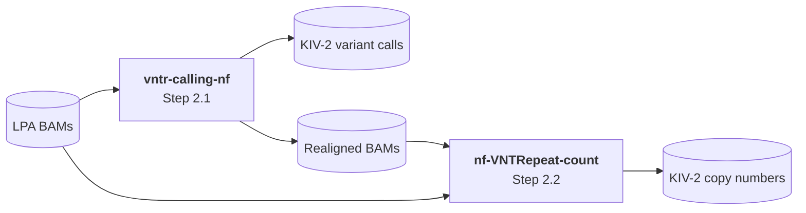

# Demo: From Short Reads to GWAS-Ready VNTR Data

The KIV-2 VNTR of *LPA* is not resolved by standard variant calling and is therefore missing from GWAS. This guide turns short-read sequencing data into the two inputs needed for GWAS and fine-mapping: a merged VCF with KIV-2 and non-repetitive *LPA* variants, and per-sample KIV-2 copy numbers. As UK Biobank data cannot be shared, it uses eight public samples from the [1000 Genomes 30x high-coverage data](https://www.internationalgenome.org/data-portal/data-collection/30x-grch38) (GRCh38). The framework can also be [applied to other VNTRs](#applying-the-framework-to-other-vntrs).

| Step | Description | Runs on test data | Reproducibility |
|---|---|---|---|
| 1 | Extract *LPA*-region reads | ✓ (BAMs provided) | conda |
| 2 | Call KIV-2 VNTR variation and estimate copy number | ✓ (output provided) | Two containerised Nextflow pipelines |
| 3 | Combine non-repetitive with repetitive region | ✓ | conda |
| 4–7 | Phenotype file, GWAS, fine-mapping, dosage extraction | Requires a cohort with phenotype data; applicable to any trait (shown for Lp(a) in UK Biobank) | |

**Run time:** On an Apple Silicon Mac, the first run takes about 5 minutes, including creating the conda environment and downloading about 4.6 GB of containers, so it depends on your connection. After that, Steps 2 and 3 take less than a minute.

## Setup

All required software is listed in [`scripts/demo/environment.yml`](scripts/demo/environment.yml). From the repository root, create the environment and a working folder in which all steps are executed:
```
conda env create --file scripts/demo/environment.yml
conda activate vntr-demo
mkdir demo && cd demo
```

Download the single-repeat KIV-2 reference, which is used in Steps 2 and 3:
```
wget https://raw.githubusercontent.com/genepi/vntr-calling-nf/v0.4.10/reference-data/kiv2.fasta
wget https://raw.githubusercontent.com/genepi/vntr-calling-nf/v0.4.10/reference-data/kiv2.fasta.fai
```

## Step 1 - Extract *LPA*-region reads

The *LPA*-region BAMs for all eight samples are already provided in [`input/bams/`](input/bams/). They were extracted from the 30x CRAMs as follows (example for HG00265; the CRAM location of each sample is listed in the [sequence index](http://ftp.1000genomes.ebi.ac.uk/vol1/ftp/data_collections/1000G_2504_high_coverage/1000G_2504_high_coverage.sequence.index)):
```
samtools view -b -o ../input/bams/HG00265.final.cram.LPA.bam \
  -T http://ftp.1000genomes.ebi.ac.uk/vol1/ftp/technical/reference/GRCh38_reference_genome/GRCh38_full_analysis_set_plus_decoy_hla.fa \
  http://ftp.sra.ebi.ac.uk/vol1/run/ERR324/ERR3240222/HG00265.final.cram \
  chr6:160530485-160665259
```

## Step 2 - Call KIV-2 VNTR variation and estimate copy number

The core of the framework is two standalone Nextflow pipelines. Each is public, version-pinned and containerised, runs with a single command on Docker or Singularity, and can be applied to other VNTRs by changing its inputs.



| | [vntr-calling-nf](https://github.com/genepi/vntr-calling-nf) | [nf-VNTRepeat-count](https://github.com/genepi/nf-VNTRepeat-count) |
|---|---|---|
| **Resolves** | Variants within the repeat, using the signature-sequence approach | Repeat copy number, from read coverage |
| **Input** | *LPA* BAMs | *LPA* BAMs, realigned BAMs and exon coordinates |
| **Output** | Per-sample variant calls with variant levels, realigned BAMs | Per-sample copy number estimates |
| **Used in** | Step 3 (merged VCF) | Steps 4–5 (phenotype file, GWAS covariate) |

[Docker](https://docs.docker.com/get-docker/) must be installed and running.

### 2.1 Call KIV-2 variants with vntr-calling-nf

KIV-2 variants are called with [vntr-calling-nf](https://github.com/genepi/vntr-calling-nf) using the signature-sequence approach. We run it on all eight samples.

Create `step2.config`:
```
params.project="1000g"
params.input="../input/bams/*.bam"
params.reference="kiv2.fasta"
params.contig="KIV2_6"
params.build="hg38"
params.publish_realigned=true
```

Run the pipeline:
```
nextflow run genepi/vntr-calling-nf -r v0.4.10 -c step2.config -profile docker
```

The VNTR calls are written to `output/1000g/variant_calling/` and the realigned BAMs needed for Step 2.2 to `output/1000g/realign_fastq/`. Our output of this step is provided with the same structure in [`input/step2-output/`](input/step2-output/), so you can compare your results with it.

### 2.2 Estimate KIV-2 copy number with nf-VNTRepeat-count

KIV-2 copy number is estimated from coverage with [nf-VNTRepeat-count](https://github.com/genepi/nf-VNTRepeat-count). The method is an adaptation of the normalized-coverage approach of [Telis et al., JACC Basic Transl Sci 2025](https://doi.org/10.1016/j.jacbts.2025.04.012) that reuses the realigned BAMs from our variant calling pipeline (Step 2.1): mean coverage of the KIV-2 exons in these BAMs divided by mean coverage of the unique *LPA* exons in the original BAMs (Step 1). The exon coordinates are provided in [`scripts/step2/input/`](scripts/step2/input/).

Create `copy_number.config`:
```
params {
    bam_dir      = "../input/bams"
    bam_dir_vntr = "../input/step2-output/realign_fastq"
    nonrep_bed   = "../scripts/step2/input/exons{1,2}.bed"
    vntr_bed     = "../scripts/step2/input/kiv2-{1,2}.bed"
}
```

Run the pipeline:
```
nextflow run genepi/nf-VNTRepeat-count -r v1.0.0 -c copy_number.config -profile docker
```

The KIV-2 copy number (`cne_vntr`) of all eight samples is written to `results/estimates/estimates.tsv`. It is the average number of KIV-2 copies per allele: coverage of the unique exons reflects the two alleles, while the single-repeat reference pools the repeats of both alleles. Twice this value is therefore the total copy number of a sample.

Your result should match the `cne_vntr` column below. For comparison, the last column shows the total copy number from the DRAGEN-based KIV-2 caller of [Behera et al., BMC Medical Genomics 2024](https://doi.org/10.1186/s12920-024-02024-0). In these eight samples, our total is on average 1.2 copies lower (r = 0.98). Across all 2,504 1000 Genomes samples in our comparison, our total is on average 1.7 copies lower (r = 0.97). This offset is similar in all ancestries (1.5 to 1.9 copies lower), with a correlation of 0.96–0.97 in African, American, European and South Asian samples and 0.94 in East Asian samples.

| Sample | `cne_vntr` | Total (2 × `cne_vntr`) | Behera et al. total |
|---|---|---|---|
| HG00265 | 15.61 | 31.21 | 31.21 |
| HG00766 | 25.84 | 51.68 | 51.79 |
| HG01685 | 12.35 | 24.70 | 24.78 |
| HG02697 | 18.72 | 37.45 | 41.14 |
| HG03391 | 17.09 | 34.18 | 35.32 |
| HG03673 | 17.14 | 34.27 | 37.44 |
| HG04186 | 20.51 | 41.01 | 40.75 |
| NA20772 | 18.12 | 36.24 | 37.78 |

## Step 3 - Combine non-repetitive with repetitive region

The VNTR calls are merged with variant calls for the non-repetitive *LPA* region. For 1000 Genomes, these come from the [high-coverage phased panel](https://www.internationalgenome.org/data-portal/data-collection/30x-grch38), which was called from the same 30x CRAMs used in Step 1. The *LPA*-region VCF for all eight samples is already provided in [`input/vcf/`](input/vcf/). It was extracted as follows:
```
bcftools view -r chr6:160530485-160665259 -c 1 \
  -s HG00265,HG00766,HG01685,HG02697,HG03391,HG03673,HG04186,NA20772 \
  -Oz -o ../input/vcf/lpa_1000g.vcf.gz \
  http://ftp.1000genomes.ebi.ac.uk/vol1/ftp/data_collections/1000G_2504_high_coverage/working/20220422_3202_phased_SNV_INDEL_SV/1kGP_high_coverage_Illumina.chr6.filtered.SNV_INDEL_SV_phased_panel.vcf.gz
```

### 3.1 Convert VNTR results to a VCF file
```
unzip ../scripts/step3/mutserve.zip

# Use sample IDs as names and keep PASS variants only
gzip -dc ../input/step2-output/variant_calling/1000g.txt.gz \
  | sed -E 's/\.[.A-Za-z0-9]*realigned\.bam//g' \
  | awk -F'\t' 'NR==1 || $2=="PASS"' > vntr_filtered.txt

# Rename the KIV-2 contig to 6
sed 's/KIV2_6/6/' kiv2.fasta > kiv2_chr6.fasta

"$JAVA_HOME/bin/java" -jar mutserve.jar create-vcf \
    --input vntr_filtered.txt \
    --output vntr_filtered.vcf.gz \
    --reference kiv2_chr6.fasta
```

### 3.2 Prepare the non-repetitive region
Rename `chr6` to `6` and add an empty DS field, which is filled from the genotypes in the next step:
```
echo "chr6 6" > chr_names.txt
echo '##FORMAT=<ID=DS,Number=1,Type=Float,Description="Genotype dosage">' > ds.hdr

bcftools annotate --rename-chrs chr_names.txt -h ds.hdr -Oz -o region_chr6.vcf.gz ../input/vcf/lpa_1000g.vcf.gz
```

### 3.3 Fix dosages and merge both regions
The KIV-2 variants are called on a single-repeat reference, where their positions have no meaning on chromosome 6. `merge_vntr_nonrep.sh` projects the variants of both KIV-2 exons onto chromosome 6 coordinates, taking into account that *LPA* lies on the reverse strand. This places repetitive and non-repetitive variants in one VCF that standard GWAS and fine-mapping tools can use directly.

The three scripts are run in this order:
1. `gt_to_dosage.sh` fills the DS field of the non-repetitive variants from their genotypes (0, 1 or 2).
2. `merge_vntr_nonrep.sh` projects the KIV-2 variants onto chromosome 6 and merges them with the non-repetitive variants.
3. `finalize_dosage.sh` sets the DS field of the KIV-2 variants from their variant level (see below) and removes the genotypes, so that all variants are analysed as dosages.
```
sh ../scripts/step3/gt_to_dosage.sh
sh ../scripts/step3/merge_vntr_nonrep.sh vntr_filtered.vcf.gz 1000g
sh ../scripts/step3/finalize_dosage.sh 1000g
```

The merged VCF is written to `1000g_combined_final_sorted_with_DS_noGT.vcf.gz`. It contains all eight samples, and all variants are encoded as dosages (DS):
- **Non-repetitive variants:** genotype dosage (0, 1 or 2).
- **KIV-2 variants:** 0 for non-carriers, and 1 + the fraction of KIV-2 repeats carrying the variant for carriers (between 1 and 2). As KIV-2 variants are present in only some of the repeats, this captures both carrier status and the intra-repeat variant level.

Your result should match [`input/expected/1000g_combined_final_sorted_with_DS_noGT.vcf.gz`](input/expected/).

## Steps 4–7 - Association and fine-mapping

The remaining steps need a large cohort with phenotype data, so they cannot be run on the 1000 Genomes test data. They apply to any trait; in the study, they were run for Lp(a) on UK Biobank as described in the [UK Biobank analysis](UKB_ANALYSIS.md):

| Step | Description | Input from this guide |
|---|---|---|
| [4 - Phenotype file](UKB_ANALYSIS.md#step-4---prepare-phenotype-file) | Combine KIV-2 copy numbers with phenotype data and covariates | Copy numbers (Step 2) |
| [5 - GWAS](UKB_ANALYSIS.md#step-5---run-combined-gwas-for-lpa-trait) | Genome-wide association for Lp(a) with regenie via [nf-gwas](https://github.com/genepi/nf-gwas), with KIV-2 copy number as covariate | Merged VCF (Step 3), phenotype file (Step 4) |
| [6 - Fine-mapping](UKB_ANALYSIS.md#step-6---fine-map-association-signals-using-susie) | SuSiE fine-mapping of the *LPA* locus using an LD matrix from the merged VCF | Merged VCF (Step 3), GWAS results (Step 5) |
| [7 - Dosages](UKB_ANALYSIS.md#step-7---extract-dosages-for-credible-set-variants) | Per-sample dosages of credible-set variants for downstream analyses | Fine-mapping results (Step 6) |

## Applying the framework to other VNTRs

The framework is not limited to *LPA* and can be applied to other coding VNTRs by providing the following inputs:

| Step | Input for a new VNTR | Parameter |
|---|---|---|
| 2.1 | Reference sequence of a single repeat unit and BED file of the VNTR region | `params.reference`, `params.region` (vntr-calling-nf) |
| 2.2 | BED files of the repetitive exons and of non-repetitive exons of the same gene | `vntr_bed`, `nonrep_bed` (nf-VNTRepeat-count) |
| 3 | Positions of the repeat exons within the repeat unit and their target coordinates on the chromosome | `merge_vntr_nonrep.sh` |

## Explore the results

The results of Steps 5 and 6 for UK Biobank are included in this repository:

- **GWAS summary statistics and LD matrices** for European, African and Asian ancestries in [`results/`](results/)
- **[LD Explorer](https://genepi.shinyapps.io/ld-explorer/)**: interactive Manhattan and LD plots of the *LPA* locus for each ancestry
