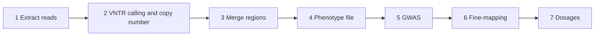

# Pipeline, Results, and Interactive Explorer for VNTR integration into multi-ancestry association studies and fine-mapping

---
## Where to start

> [!TIP]
> **▶️ [Run the demo](DEMO.md):** try the framework on eight public 1000 Genomes samples, with all input data and expected results included.
>
> **📖 [Read the UK Biobank analysis](UKB_ANALYSIS.md):** all steps of the study as run on the UK Biobank Research Analysis Platform (RAP).
>
> **📊 [Explore the results](https://genepi.shinyapps.io/ld-explorer/):** interactive Manhattan and LD plots of the *LPA* locus.

> **Data availability:** Due to UK Biobank data access restrictions, we are unable to share non-aggregated data or sample IDs. Analyses were conducted under UKB application number **62905**. Please apply for data access directly through the [UK Biobank](https://www.ukbiobank.ac.uk/).

If you encounter any issues running the pipeline, please [open a GitHub issue](../../issues). For other enquiries, contact [Sebastian Schönherr](https://genepi.i-med.ac.at/team/schoenherr-sebastian/).

---
## Overview

Lipoprotein(a) [Lp(a)] is a major heritable cardiovascular risk factor whose plasma levels are largely determined by variation at the *LPA* locus. A key source of this variation is the kringle IV type 2 (KIV-2) variable number tandem repeat (VNTR), a highly repetitive region that is refractory to standard short-read alignment and therefore routinely excluded from GWAS. Accurately resolving KIV-2 copy number and intra-repeat sequence variation is essential for capturing the full genetic architecture of Lp(a) and for identifying causal variants through fine-mapping.

This repository documents the computational pipeline to integrate VNTR variation into GWAS analysis:

1. [Extract *LPA*-region reads](UKB_ANALYSIS.md#step-1---extract-lpa-region-reads-from-uk-biobank-whole-exome-sequencing-wes-cram-files)
2. [Call KIV-2 VNTR variation and estimate copy number](UKB_ANALYSIS.md#step-2---call-kiv-2-vntr-variation-and-estimate-copy-number-from-bamcram-files), using two Nextflow pipelines
3. [Combine non-repetitive with repetitive region](UKB_ANALYSIS.md#step-3---combine-non-repetitive-with-repetitive-region)
4. [Prepare phenotype file](UKB_ANALYSIS.md#step-4---prepare-phenotype-file)
5. [Run combined GWAS](UKB_ANALYSIS.md#step-5---run-combined-gwas-for-lpa-trait)
6. [Fine-map association signals using SuSiE](UKB_ANALYSIS.md#step-6---fine-map-association-signals-using-susie)
7. [Extract dosages for credible-set variants](UKB_ANALYSIS.md#step-7---extract-dosages-for-credible-set-variants)

---
## What's in this repository

| Component | Location | Description |
|---|---|---|
| **Demo** | [`DEMO.md`](DEMO.md) | Runnable example on public 1000 Genomes data, with input data in [`input/`](input/) |
| **UK Biobank analysis** | [`UKB_ANALYSIS.md`](UKB_ANALYSIS.md), [`scripts/`](scripts/) | Documentation and scripts of the full analysis on UKB RAP |
| **Summary results** | [`results/`](results/) | GWAS summary statistics and LD-residual files for European, African, and Asian ancestries |
| **Shiny app** | [`shiny_app/`](shiny_app/) | Interactive Manhattan/LD-residual explorer across ancestries |

To launch the Shiny app locally, open `shiny_app/app.R` in RStudio and click *Run App*, or run `shiny::runApp("shiny_app")` from the repository root.

---
## Funding

This work is supported by the Austrian Science Fund (FWF) under grant [PAT3357425 — Intra-Repeat VNTR Analysis and Risk Prediction](https://www.fwf.ac.at/forschungsradar/10.55776/PAT3357425) (PI: Sebastian Schönherr, Medical University Innsbruck).

---
## Contributors

[Institute of Genetic Epidemiology](https://genepi.i-med.ac.at/), Innsbruck

- **[Silvia Di Maio](https://genepi.i-med.ac.at/team/di-maio-silvia/)** 
- **[Johanna F. Schachtl-Rieß](https://genepi.i-med.ac.at/team/schachtl-riess-johanna/)**
- **[Stefan Coassin](https://genepi.i-med.ac.at/team/coassin-stefan/)** 
- **[Sebastian Schönherr](https://genepi.i-med.ac.at/team/schoenherr-sebastian/)**
