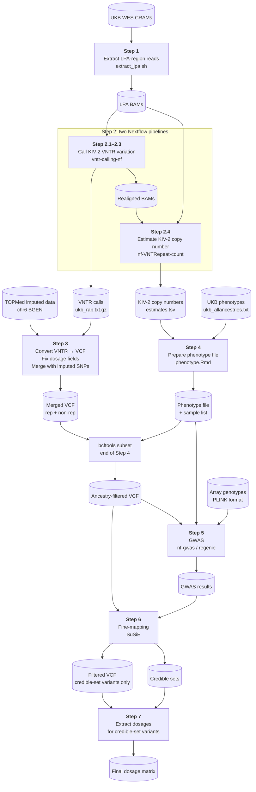

# UK Biobank Analysis

This document describes all steps of the analysis as run on the UK Biobank Research Analysis Platform (RAP). If you are new to RAP, have a look at the [Getting started with RAP](#getting-started-with-rap) section below. To try the framework without UK Biobank access, see the [demo](DEMO.md).

> **Data availability:** Due to UK Biobank data access restrictions, we are unable to share non-aggregated data or sample IDs. Analyses were conducted under UKB application number **62905**. Please apply for data access directly through the [UK Biobank](https://www.ukbiobank.ac.uk/).

> **Note on genome builds:** Read extraction, KIV-2 variant calling and copy-number estimation (Steps 1–2) are performed on the UK Biobank exome CRAMs, which are aligned to GRCh38, for all ancestries. For merging with imputed data (Step 3), this guide documents the GRCh38/TOPMed workflow used for African and South Asian participants. 

## Pipeline Overview

The pipeline consists of the following steps:

1. Extract *LPA*-region reads from UK Biobank whole-exome sequencing (WES) CRAM files
2. Call KIV-2 VNTR variation and estimate copy number from BAM/CRAM files
3. Combine non-repetitive with repetitive region
4. Prepare phenotype file
5. Run combined GWAS for Lp(a) trait
6. Fine-map association signals using SuSiE
7. Extract dosages for credible-set variants




## Step 1 - Extract *LPA*-region reads from UK Biobank whole-exome sequencing (WES) CRAM files

The CRAMs are stored in a bucket that cannot be accessed directly. We therefore download the *LPA* CRAM files and extract the region.

### Input/Output
| | Files |
|---|---|
| **Input** | `ids_by_ancestry.txt` (e.g. full paths for a specific ancestry) |
| **Output** | Per-sample *LPA* BAMs (region chr6:160530483–160665260) |
| **Script** | `scripts/step1/extract_lpa.sh` |

### Workflow
* Execute `dx find data --path "Bulk/Exome sequences/Exome OQFE CRAM files" --name "*.cram" > ids.txt`
* Filter ids.txt by ancestry and save as `ids_by_ancestry.txt`
* Execute `scripts/step1/extract_lpa.sh`.

## Step 2 - Call KIV-2 VNTR variation and estimate copy number from BAM/CRAM files

VNTR variation is resolved using a previously [published Nextflow pipeline](https://github.com/genepi/vntr-calling-nf). KIV-2 copy number is then estimated with [nf-VNTRepeat-count](https://github.com/genepi/nf-VNTRepeat-count), an adaptation of the normalized-coverage approach of [Telis et al.](https://doi.org/10.1016/j.jacbts.2025.04.012) that reuses the realigned BAMs.

### Input/Output
| | Files |
|---|---|
| **Input** | *LPA* BAMs from Step 1 |
| **Output** | VNTR calls (`ukb_rap.txt.gz`); realigned BAMs (`realign_fastq/`); per-sample KIV-2 copy numbers (`estimates.tsv`) |
| **Script** | `nextflow run genepi/vntr-calling-nf -c ukb.config` ([vntr-calling-nf](https://github.com/genepi/vntr-calling-nf)), `nextflow run genepi/nf-VNTRepeat-count -c copy_number.config` ([nf-VNTRepeat-count](https://github.com/genepi/nf-VNTRepeat-count)) |

### 2.1 Set up the pipeline
Download the ROI-8 BED file (do not use the signature approach; only validated in EUR). For EUR, set `params.build="hg38"` and remove `params.region`.
```
wget https://raw.githubusercontent.com/genepi/vntr-calling-nf/refs/heads/main/paper_analysis/lpa/bed/hg38/ROI-8.bed
```

### 2.2 Create a config file
Create `ukb.config`:
```
params.project="ukb_rap_ancestry"
params.input="lpa_bams/*bam"
params.reference="reference-data/kiv2.fasta"
params.contig="KIV2_6"
params.region="ROI-8.bed"
params.publish_realigned=true
```

`params.publish_realigned=true` writes the realigned BAMs needed for Step 2.4 to `output/<project>/realign_fastq/`.

### 2.3 Run the pipeline
```
nextflow run genepi/vntr-calling-nf -r <version> -c ukb.config -profile docker
```

> **Note:** Pin `-r` to a specific release tag (current: `-r v0.4.10`) to ensure reproducibility. Check available releases at [github.com/genepi/vntr-calling-nf](https://github.com/genepi/vntr-calling-nf/releases).

### 2.4 Estimate KIV-2 copy number
The BED files with the exon coordinates are provided in [`scripts/step2/input/`](scripts/step2/input/). Create `copy_number.config`:
```
params {
    bam_dir      = "lpa_bams"
    bam_dir_vntr = "output/ukb_rap_ancestry/realign_fastq"
    nonrep_bed   = "scripts/step2/input/exons{1,2}.bed"
    vntr_bed     = "scripts/step2/input/kiv2-{1,2}.bed"
}
```

Run the pipeline:
```
nextflow run genepi/nf-VNTRepeat-count -r v1.0.0 -c copy_number.config -profile docker
```

The KIV-2 copy numbers are written to `results/estimates/estimates.tsv`, which is the input of Step 4.

## Step 3 - Combine non-repetitive with repetitive region
The VNTR calls from Step 2 are converted to VCF format and merged with TOPMed imputed SNPs covering the non-repetitive *LPA* locus. Dosage (DS) fields are harmonised across both sources to produce a single analysis-ready VCF.

> **European participants:** instead of the TOPMed data, the non-repetitive *LPA* region was taken from the UK Biobank v3 imputation (GRCh37), and KIV-2 variant positions were projected onto GRCh37 coordinates. All other steps are identical.

### Input/Output
| | Files |
|---|---|
| **Input** | `ukb_rap.txt.gz` (VNTR calls from Step 2), `ukb21007_c6_b0_v1.bgen/.sample` (TOPMed imputed data, chr6 *LPA* locus) |
| **Output** | `ukb_combined_final_sorted_with_DS_noGT.vcf.gz` — merged VCF of VNTR repetitive region + imputed non-repetitive region, with DS dosage field |
| **Script** | `scripts/step3/gt_to_dosage.sh`, `scripts/step3/merge_vntr_nonrep.sh`, `scripts/step3/finalize_dosage.sh` |

### 3.1 Convert VNTR results to a VCF file

```
wget https://github.com/seppinho/mutserve/releases/download/v2.0.3/mutserve.zip
unzip mutserve.zip

# Fix IDs to allow merging with imputed data
gzip -dc ukb_rap.txt.gz | sed -e 's/_23143_0_0_lpa.extracted.kiv2.realigned.bam//g' > ukb_rap_renamed.txt

# Filter by PASS
awk -F'\t' 'NR==1 || $2=="PASS"' ukb_rap_renamed.txt > ukb_rap_renamed_filtered.txt

# Prepare reference (rename KIV2_6 to 6 to avoid merging issues)
wget https://raw.githubusercontent.com/genepi/vntr-calling-nf/refs/heads/main/reference-data/kiv2.fasta
# Edit kiv2.fasta: change "KIV2_6" to "6"

java -jar mutserve.jar create-vcf \
    --input ukb_rap_renamed_filtered.txt \
    --output ukb_rap_renamed_filtered.vcf.gz \
    --reference kiv2.fasta
```

### 3.2 Download the *LPA* non-repetitive region from TOPMed
```
qctool \
-g "ukb21007_c6_b0_v1.bgen" \
-s "ukb21007_c6_b0_v1.sample" \
-incl-range 6:160530484-160665259 \
-og "region_chr6.bgen"
```

### 3.3 Fix dosage fields in the non-repetitive region
The non-repetitive region may lack DS for 0/0 genotypes and sometimes contains only GT. We fix this by replacing GT-only entries with 0, 1, or 2 and by adding DS where DS is ".". The script is available in `scripts/step3`.

```
sh gt_to_dosage.sh
```

### 3.4 Merge non-repetitive and repetitive regions
```
sh merge_vntr_nonrep.sh
sh finalize_dosage.sh
```

## Step 4 - Prepare phenotype file

The per-sample KIV-2 copy numbers from Step 2.4 are combined with Lp(a) phenotype data and covariates into a single phenotype file used for GWAS.

### Input/Output
| | Files |
|---|---|
| **Input** | `estimates.tsv` from Step 2.4, `ukb_allancestries.txt` |
| **Output** | `phenotype_ukb_estimates_ancestry.txt` (per-sample KIV-2 copy number + Lp(a) phenotype + covariates) |
| **Script** | `scripts/step4/phenotype.Rmd` |

The Rmd script requires a tab-separated phenotype file (`ukb_allancestries.txt`) containing the following UK Biobank fields:

| Column | UKB Field | Description |
|---|---|---|
| `f.eid` | — | Sample identifier |
| `f.30790.0.0` | [30790](https://biobank.ndph.ox.ac.uk/showcase/field.cgi?id=30790) | Lp(a) plasma level (nmol/L), including out-of-range values (requires separate UKB data request) |
| `f.21000.0.0` | [21000](https://biobank.ndph.ox.ac.uk/showcase/field.cgi?id=21000) | Ethnic background (used for ancestry stratification) |
| `f.31.0.0` | [31](https://biobank.ndph.ox.ac.uk/showcase/field.cgi?id=31) | Sex |
| `f.21022.0.0` | [21022](https://biobank.ndph.ox.ac.uk/showcase/field.cgi?id=21022) | Age at recruitment |
| `f.22000.0.0` | [22000](https://biobank.ndph.ox.ac.uk/showcase/field.cgi?id=22000) | Genotype measurement batch |
| `f.22009.0.1`–`f.22009.0.30` | [22009](https://biobank.ndph.ox.ac.uk/showcase/field.cgi?id=22009) | Genetic principal components 1–30 |

Ancestry is derived from field 21000 using the following coding: White (1001–1003), Mixed (2001–2004), Asian (3001–3004), Black (4001–4003), Chinese (5).

- Start an RStudio instance and open a terminal within RStudio.
- Run the Rmd script to create the phenotype file (`scripts/step4/phenotype.Rmd`).
- Ensure matching sample sets between VCF and phenotype file (especially necessary for fine-mapping). The Rmd script writes the ancestry-specific sample list to `output/samples_<ancestry>.txt` (e.g. `samples_africans.txt`). Use this to subset the merged VCF from Step 3:

```
bcftools view --force-samples -S output/samples_africans.txt \
  -Oz -o ukb_combined_final_sorted_with_DS_noGT_afr.vcf.gz \
  ukb_combined_final_sorted_with_DS_noGT.vcf.gz
```

## Step 5 - Run combined GWAS for Lp(a) trait

A genome-wide association study for Lp(a) is run using regenie via the nf-gwas Nextflow pipeline. The merged VCF (Step 3) and phenotype file (Step 4) are used as input, with genome-wide array genotypes (chromosomes 1–22) for regenie's whole-genome regression (regenie Step 1).

| | Files |
|---|---|
| **Input** | `ukb_combined_final_sorted_with_DS_noGT_afr.vcf.gz` (Step 4, ancestry-filtered), `phenotype_ukb_estimates_ancestry.txt` + covariates file (Step 4), array genotypes `ukb22418_c{1..22}_b0_v2.*` (PLINK format, merged to `ukb22418_c1_22_merged.*`) |
| **Output** | GWAS summary statistics `lpa.regenie_<ancestry>.gz` |
| **Script** | `scripts/step5/gwas.config` (`nextflow run genepi/nf-gwas -c gwas.config`) |

### 5.1 Prepare GWAS

Regenie Step 1 fits the whole-genome regression model on the array genotypes of all autosomes. Download them and merge them into one PLINK fileset:
```
for chr in {1..22}; do
  dx download "Bulk/Genotype Results/Genotype calls/ukb22418_c${chr}_b0_v2.*"
done
for chr in {2..22}; do echo ukb22418_c${chr}_b0_v2; done > merge_list.txt
plink --bfile ukb22418_c1_b0_v2 --merge-list merge_list.txt --make-bed --out ukb22418_c1_22_merged
```

- Prepare covariates file: `cp phenotype_ukb_estimates_ancestry.txt phenotype_ukb_estimates_ancestry_covariates.txt`

### 5.2 Run GWAS
```
nextflow run genepi/nf-gwas -c gwas.config -profile docker
```

## Step 6 - Fine-map association signals using SuSiE

Statistical fine-mapping is performed on the GWAS summary statistics using SuSiE (Sum of Single Effects). An LD matrix is computed from the ancestry-filtered merged VCF and used alongside the regenie output to identify credible sets of causal variants at the *LPA* locus.

| | Files |
|---|---|
| **Input** | `input/ukb_combined_final_sorted_with_DS_noGT_afr.vcf.gz` (Step 4, ancestry-filtered VCF), `input/lpa.regenie.gz` (GWAS results from Step 5, renamed) |
| **Output** | Credible sets table, LD matrix (`UKB_<ancestry>_ld_residuals.txt`), SuSiE diagnostics plot (`output/susie_diagnostics_plot_*.png`) |
| **Script** | `scripts/step6/prepare.sh`, `scripts/step6/finemapping.R` |

### 6.1 Prepare fine-mapping input

Create an `input/` directory and place the following files in it before running the script:

```
mkdir -p input

# Ancestry-filtered VCF from Step 4
cp ukb_combined_final_sorted_with_DS_noGT_afr.vcf.gz input/

# GWAS summary statistics from Step 5 — rename to lpa.regenie.gz
cp <nf-gwas results dir>/f.30790.0.0.regenie.gz input/lpa.regenie.gz
```

Then run the script, which subsets the VCF to only the variants present in the regenie output:
```
bash prepare.sh
```

### 6.2 Run fine-mapping
```
Rscript finemapping.R
```

## Step 7 - Extract dosages for credible-set variants

Genotype dosages are extracted for each variant in the credible sets identified in Step 6. The output is a per-sample dosage matrix used for downstream association and variance-explained analyses.

| | Files |
|---|---|
| **Input** | `input/ukb_kiv2_estimates_final_sorted_with_DS_noGT_afr_filtered.vcf.gz` (Step 6 output), `input/afr_credible_sets_pos.txt` (Step 6 output) |
| **Output** | `snps_dosages_estimates_afr.csv` — sample × credible-set variant dosage matrix |
| **Script** | `scripts/step7/extract_dosages.sh` (requires `genomic-utils.jar`) |

Place the Step 6 outputs into `input/` before running:

```
mkdir -p input
cp ukb_kiv2_estimates_final_sorted_with_DS_noGT_afr_filtered.vcf.gz input/
cp output/afr_credible_sets_pos.txt input/
```

---


## Software Versions

| Tool | Version | Used in |
|---|---|---|
| Nextflow | ≥25.10 | Steps 2, 5 |
| [vntr-calling-nf](https://github.com/genepi/vntr-calling-nf) | 0.4.10 | Step 2 |
| [nf-VNTRepeat-count](https://github.com/genepi/nf-VNTRepeat-count) | 1.0.0 | Step 2 |
| [nf-gwas](https://github.com/genepi/nf-gwas) | 1.0.11 | Step 5 |
| mutserve | 2.0.3 | Step 3 |
| qctool | — | Step 3 |
| bcftools | — | Steps 3, 4, 6 |
| PLINK 1.9 | — | Step 5 |
| R | — | Steps 4, 6 |
| genomic-utils | — | Step 7 |

R packages used in Steps 4 and 6: `dplyr`, `tidyr`, `ggplot2`, `stringr`, `knitr` (Step 4); `susieR`, `vcfR`, `Matrix`, `data.table`, `tidyverse`, `R.utils` (Step 6). Pin package versions using `renv` or record `sessionInfo()` output for reproducibility.

---

## Scripts Structure

```
.
├── scripts/
│   ├── environment/
│   │   └── environment.yml           # conda environment for DNAnexus CLI
│   ├── step1/
│   │   └── extract_lpa.sh            # Step 1: download CRAMs, extract LPA BAMs
│   ├── step2/
│   │   └── input/
│   │       ├── exons1.bed            # Step 2: BED files for copy number estimation
│   │       ├── exons2.bed
│   │       ├── kiv2-1.bed
│   │       └── kiv2-2.bed
│   ├── step3/
│   │   ├── gt_to_dosage.sh           # Step 3: fill missing DS fields from GT in non-repetitive VCF
│   │   ├── merge_vntr_nonrep.sh      # Step 3: merge VNTR + imputed VCF
│   │   └── finalize_dosage.sh        # Step 3: set final DS in merged VCF and remove GT
│   ├── step4/
│   │   └── phenotype.Rmd             # Step 4: KIV-2 copy number + GWAS phenotype
│   ├── step5/
│   │   └── gwas.config            # Step 5: nf-gwas / regenie config
│   ├── step6/
│   │   ├── prepare.sh                # Step 6: subset VCF to regenie variants
│   │   └── finemapping.R             # Step 6: SuSiE fine-mapping
│   └── step7/
│       └── extract_dosages.sh        # Step 7: credible-set SNP dosage extraction
```

---

## Getting started with RAP

### Setup
Activate (or build) the conda environment locally to connect to RAP:
```
# Only if the environment does not exist
conda env create --file environment.yml
conda activate dna-nexus
```

### Start a workstation

Start a basic workstation inside RAP:
```
dx run cloud_workstation -imax_session_length=1h --allow-ssh --brief -y --name "PROJECT_NAME"
# Returns job-id
```

### Start a workstation with a snapshot

A snapshot bundles all software needed to run the pipeline and can be created with `dx-create-snapshot` ([docs](https://academy.dnanexus.com/interactivecloudcomputing/cloudworkstation#snapshot)). We recommend installing software into a mamba environment within the snapshot.

```
dx run cloud_workstation \
  -imax_session_length=24h \
  -isnapshot=file-XX \
  --allow-ssh \
  --brief \
  -y \
  --name "lpa_vntr"
```

### Connect to an instance

SSH configuration is only required once every 30 days:
```
dx ssh_config
# Connect to your job
dx ssh job-XXX
```

Find running machines:
```
dx find jobs --state running
```

### Initialise the workstation environment

After connecting, activate the connection to the buckets:
```bash
unset DX_WORKSPACE_ID
dx cd $DX_PROJECT_CONTEXT_ID:
```
